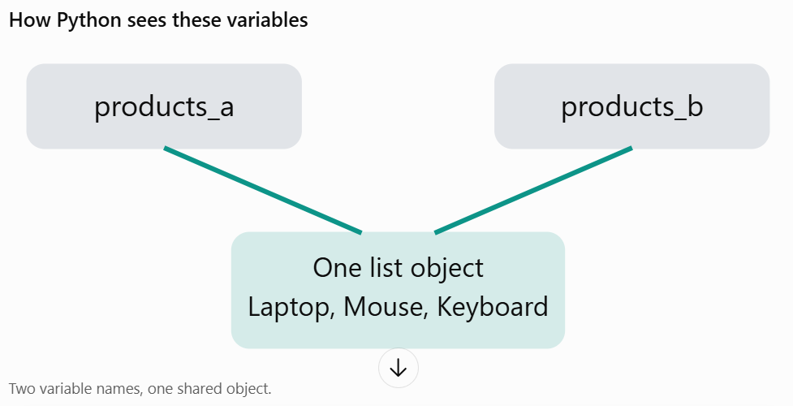

## Arithmetic operators
These perform mathematical operations.

| Operator | Meaning | Example |
|----------|---------|---------|
| +        | Addition | 10 + 5 |
| -        | Subtraction | 10 - 5 |
| *        | Multiplication | 10 * 5 |
| /        | Division | 10 / 5 |
| //       | Floor division | 11 // 2 |
| %        | Modulus | 11 % 2 |
| **       | Exponentiation | 2 ** 3 |


## Comparison operators
```
price = 1000
print(price > 500)
print(price < 500)
print(price == 1000)
print(price != 1000)
print(price >= 1000)
print(price <= 1000)
```
## Logical operators
Three important logical operators:

| Operator | Meaning |
|----------|---------|
| and      | Both conditions must be true |
| or       | At least one condition must be true |
| not      | Reverses the Boolean value |

## Assignment Operator

total = 100

total += 50
total -= 20
total *= 2
total /= 2

## Condition statement
```
sales = 150000

if sales >= 200000:
print("Excellent performance")
elif sales >= 100000:
print("Good performance")
elif sales >= 50000:
print("Average performance")
else:
print("Poor performance")
```
## Ternary operator
```
stock = 10

status = "Available" if stock > 0 else "Out of stock"

print(status)
```
## List
A list stores multiple values in an ordered, mutable collection.
```
products = ["Keyboard", "Mouse", "Monitor"]

products.append("Laptop")
products.remove("Mouse")

print(products)
```

|Operation|	Purpose|
|--|--|
|append()|	Add an element|
|insert()|	Add at a position|
|remove()|	Remove by value|
|pop()|	Remove by index|
|sort()|	Sort the list|
|len()|	Count elements|

```
products = ["Keyboard", "Mouse", "Monitor"]

print(products[0])
print(products[-1])
```

Output
```
Keyboard
Monitor
```

Slicing 

```
print(products[0:2])
```

Output first two elements
```
['Keyboard', 'Mouse']
```

## Tuple
A tuple is ordered but immutable.

```
store_location = ("Delhi", "India")
```
When to use it?

When you want to represent a fixed collection of values, such as coordinates or fixed configuration data.

## Set
A set stores unique elements.

```
categories = {"Electronics", "Clothing", "Electronics"}

print(categories)
```

Output:
```
{'Electronics', 'Clothing'}
```
Only unique values remain.

Useful for:
- Removing duplicates.
- Finding unique categories.
- Finding common elements.
- Finding differences between collections.

```
store_a = {"Keyboard", "Mouse", "Monitor"}
store_b = {"Mouse", "Laptop"}

print(store_a.intersection(store_b))
```
Output:
```
{'Mouse'}
```
## Dictionary

A dictionary stores data in key-value pairs.

```
product = {
    "product_id": 101,
    "product_name": "Keyboard",
    "price": 1000,
    "quantity": 10
}
```
Access Value
```
print(product["product_name"])
print(product["price"])
```
Add
```
product["category"] = "Electronics"
print(product)
```
Output:
```
{'product_id': 101, 'product_name': 'Keyboard', 'price': 1000, 'quantity': 10, 'category': 'Electronics'}
```
```
for key, value in product.items():
    print(key, value)
```

| Collection comparison Feature | 	List |	Tuple|	Set|	Dictionary|
|-------------------------------|-------|---|---|---|
| Ordered                       | 	Yes  |	Yes|	No| positional order|	Yes|
| Mutable	                      | Yes	  | No	   | Yes	  | Yes   |
|Duplicates|	Yes|	Yes|	No|	Keys unique|
|Access|	Index|	Index|	No index|	Key|

## Function

### Multiple return values
```
def calculate_sales(price, quantity=1):
    gross = price * quantity
    tax = gross * 0.18
    return gross, tax

gross, tax = calculate_sales(1000, 2)
```

## Lambda functions

A lambda is a small anonymous function.

```
calculate_tax = lambda amount: amount * 0.18

print(calculate_tax(1000))
```
180

## List comprehension

Traditional approach:

```
prices = [100, 500, 700, 1000, 1500]

expensive = []

for price in prices:
    if price > 500:
        expensive.append(price)
```

List comprehension approach:

```
prices = [100, 500, 700, 1000, 1500]

expensive = [price for price in prices if price > 500]

prices = [100, 200, 300]

increased_prices = [price * 1.10 for price in prices]
```
General structure:
```
[expression for item in collection if condition]
```

### Mutable and Immutable objects

What does mutable mean?
- Mutable: An object can be changed after it is created.
- Immutable: An object cannot be changed after it is created.

|Mutable objects| 	Immutable objects |
|-----|--------------------|
|list| 	int               |
|dict| 	float             |
|set| 	bool              |
|bytearray| 	str               |
|| 	frozenset         |
|| tuple              |
|| bytes              |

Mutable example
```
products = ["Laptop", "Mouse", "Keyboard"]

products.append("Monitor")

print(products)

```

The existing list is modified. Python does not need to create a new list for this operation.

Immutable example

```
product_name = "Laptop"

product_name.upper()

print(product_name)
```
Laptop

Because upper() returns a new string. It does not modify the original string.

```
product_name = product_name.upper()
```
output LAPTOP

### Assignment does not copy an object

```
products_a = ["Laptop", "Mouse"]

products_b = products_a

products_b.append("Keyboard")

print(products_a)
print(products_b)
```

Both variables refer to the same list.



How to create a separate copy

```
products_a = ["Laptop", "Mouse"]

products_b = products_a.copy()

products_b.append("Keyboard")

print(products_a)
print(products_b)
```

Now the original list remains unchanged.

Remember: b = a creates another reference, not a copy.

## Shallow copy vs deep copy

```
inventory = {
    "electronics": ["Laptop", "Mouse"],
    "furniture": ["Chair", "Table"]
}
```

Shallow Copy
```
import copy

inventory_copy = copy.copy(inventory)

inventory_copy["electronics"].append("Keyboard")

print(inventory)
print(inventory_copy)
```

The outer dictionary is copied, but its nested lists are still shared.

Therefore, the original inventory also contains "Keyboard".

Deep Copy

```
inventory_copy = copy.deepcopy(inventory)

inventory_copy["electronics"].append("Keyboard")
```

This creates copies of nested objects too. The original inventory remains unchanged.

## Equality vs identity

== vs is

== checks for equality (are the values the same?)
is checks for identity (are they the same object in memory?)

```
a = [10, 20]
b = [10, 20]

print(a == b) // True
print(a is b)  // False
```

```
customer_id = None

if customer_id is None:
    print("Customer ID is missing")
```

## Pass by object reference

Python uses object-reference passing, often called call by sharing.

```
def add_product(products):
    products.append("Monitor")

inventory = ["Laptop", "Mouse"]

add_product(inventory)

print(inventory)
```

The original list changes because the function modifies the shared mutable object.

```
def replace_inventory(products):
    products = ["Chair", "Table"]

inventory = ["Laptop", "Mouse"]

replace_inventory(inventory)

print(inventory)
```

The original list does not change. The function only reassigns its local parameter

Step 1: Create the inventory list
```
inventory = ["Laptop", "Mouse"]
```
Python creates a list object in memory.

The variable inventory refers to that object

```
    Inventory
        |
        v
    +-----------------+
    |  "Laptop"      | List Object A
    |  "Mouse"       |
    +-----------------+
```

Step 2: Call the function
```
replace_inventory(inventory)
```
Python passes a reference to the same list object into the function.

Now both names refer to the same object:

```
    Inventory
        |
        v
    +-----------------+
    |  "Laptop"      | List Object A
    |  "Mouse"       |
    +-----------------+
        ^
        |
    Products
```

Step 3: The critical line
```
products = ["Chair", "Table"]
```
Python creates a completely new list object (B), then makes the local variable products refer to it.

It does NOT modify the original list object (A).

```
    inventory
        |
        v
    +-----------------+
    |  "Laptop"      | List Object A
    |  "Mouse"       |
    +-----------------+
    products
        |
        v
    +-----------------+
    |  "Chair"       | List Object B
    |  "Table"       |
    +-----------------+
```


Step 4: Function completes
When the function finishes, its local variable products goes out of scope.

The original inventory variable still refers to object A.

That's why the output is:
```
['Laptop', 'Mouse']
```


Now compare these two examples
Example A — Reassignment (original does not change)

```
def replace_inventory(products):
    products = ["Chair", "Table"]

inventory = ["Laptop", "Mouse"]
replace_inventory(inventory)

print(inventory)
```

Example B — Mutation (original changes)
```
def replace_inventory(products):
    products.clear()
    products.extend(["Chair", "Table"])

inventory = ["Laptop", "Mouse"]
replace_inventory(inventory)

print(inventory)
```
output:
```
['Chair', 'Table']
```

```
try
a = [10, 20]
b = a

a = a + [30]

print(a) //[10,20,30]
print(b) //[10,20]
```
compare
```
a = [10, 20]
b = a

a.append(30)

print(a) //[10,20,30]
print(b) //[10,20,30]
```


## Variable scope

Scope means where a variable can be accessed.

Python follows the LEGB lookup order:
1. Local: Inside the current function.
2. Enclosing: Inside an outer function.
3. Global: At module level.
4. Built-in: Python's built-in names, such as len() and print().

## enumerate

enumerate() — index and value together

```
products = ["Laptop", "Mouse", "Keyboard"]

for index, product in enumerate(products):
    print(index, product)
```

## zip()

zip() — combine collections

```
products = ["Laptop", "Mouse", "Keyboard"]
prices = [50000, 800, 1500]

for product, price in zip(products, prices):
    print(product, price)
```

## Membership operators

```
product = "Laptop"

print(product in ["Laptop", "Mouse"])
print(product not in ["Chair", "Table"])
```

## any() and all()
* any() is true if at least one condition is true.
* all() is true only if every condition is true.
```
stock = [10, 0, 5]

print(any(quantity == 0 for quantity in stock))
print(all(quantity > 0 for quantity in stock))
```

## sorted() vs .sort()
* `sorted()` returns a new sorted list, leaving the original list unchanged.
* `.sort()` sorts the list in place, modifying the original list.
```
numbers = [3, 1, 4, 1, 5, 9, 2, 6]

sorted_numbers = sorted(numbers)
print(sorted_numbers)  // [1, 1, 2, 3, 4, 5, 6, 9]
print(numbers)       // [3, 1, 4, 1, 5, 9, 2, 6]

numbers.sort()
print(numbers)       // [1, 1, 2, 3, 4, 5, 6, 9]
```

## map(), filter() and comprehensions
```
prices = [100, 200, 300, 400]

updated_prices = list(map(lambda p: p * 1.18, prices))

expensive_prices = list(filter(lambda p: p > 200, prices))

# Comprehensions
updated_prices_comprehension = [p * 1.18 for p in prices]
expensive_prices_comprehension = [p for p in prices if p > 200]
```

## Dictionary Comprehensions

```
products = ["Laptop", "Mouse", "Keyboard"]

product_codes = {
    product: len(product)
    for product in products
}
```

## *args and **kwargs

*args allows you to pass a variable number of positional arguments to a function.

```
def calculate_total(*prices):
    return sum(prices)

print(calculate_total(100, 200, 300))
```

**kwargs allows you to pass a variable number of keyword arguments to a function.

```
def create_product(**details):
    print(details)

create_product(name="Laptop", price=50000, quantity=5)
```

## None
```
customer_id = None

if customer_id is None:
    print("Customer not assigned")
```

## pass
```
def calculate_revenue():
    pass
```

## Docstrings

Docstrings are used to document your code. They are strings that appear as the first statement in a function, class, or module.

```
def calculate_revenue(price, quantity):
    """Calculate gross revenue for a product."""
    return price * quantity
```

You can inspect the documentation using:
```
help(calculate_revenue)
```

## Modules and imports
```
src/
    calculations.py
    main.py
```

Inside calculations.py:
```
def calculate_total(price, quantity):
    return price * quantity
```
Inside main.py:
```
from calculations import calculate_total

print(calculate_total(100, 5))
```

## File paths and encoding
For your project, use pathlib instead of hardcoding file paths.

```
from pathlib import Path

data_path = Path("data") / "raw" / "transactions.csv"

print(data_path.exists())
```
```
with open("summary.txt", "r", encoding="utf-8") as file:
content = file.read()

```
