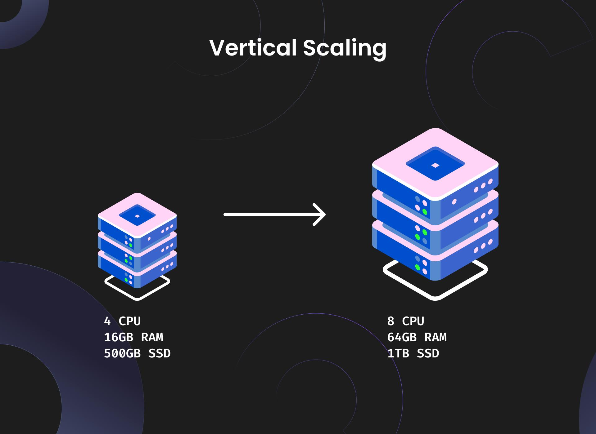
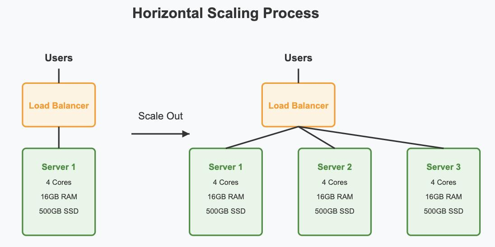

## Agenda
1. [IP Addressing](#ip-addressing)
    i. [IPv4](#ipv4---internet-protocol-version-4)
    ii. [IPv6](#ipv6---internet-protocol-version-6)
2. [NAT (Public and private IPs)](#nat-public-and-private-ips)
3. [Static and Dynamic IPs](#static-and-dynamic-ips)
4. [ICANN](#icann)
5. [Vertical and Horizontal Scaling](#vertical-and-horizontal-scaling)
6. [API Gateway](#api-gateway)
    i. [RateLimiting](#ratelimiting)    
    ii. [Throttling](#throttling)


### IP Addressing
IP Address is a unique identifier assigned to each device connected to a network that uses the Internet Protocol
#### IPv4 - Internet Protocol Version 4
1. 32-bit address format 
2. Total 4.3 billion addresses
3. Written in decimal format (e.g.,192.123.1.1)
4. Challenge - Limited IPs, Exhaustion of IPv4 addresses
5. Uses NAT to extend address space

#### IPv6 - Internet Protocol Version 6
1. 128-bit address format
2. Vastly larger address space (3.4 x 10^38 addresses)
3. Written in hexadecimal format (e.g., 2001:0db8:85a3:0000:0000:8a2e:0370:7334)
4. Designed to replace IPv4, addressing exhaustion issues

###  NAT (Public and private IPs)

#### Public Ips
1. Assigned by ISPs
2. Unique across the internet
3. Used for external communication
4. Can be static or dynamic
5. Requires registration with a central authority (IANA/Regional Internet Registries)
6. Examples: Web servers, email servers

#### Private Ips
1. Used within private/local networks
2. Cannot be accessed directly from the internet
3. Ranges defined by RFC 1918
4. Benefits - 
   * Security (if any one know private ip address still system is not assessable for direct use)
   * Scalability (reuse of IPs in different networks)
   * Cost-effective (no need to register with central authority for private IPs)- get one public address and create multiple private IPs using NAT


### Static and Dynamic IPs

| Factor              | Static IP                                                           | Dynamic IP                                              |
| ------------------- | ------------------------------------------------------------------- | ------------------------------------------------------- |
| **Definition**      | IP address remains fixed                                            | IP address can change over time                         |
| **Assignment**      | Manually configured or reserved by ISP                              | Automatically assigned, commonly through DHCP           |
| **Stability**       | High                                                                | May change after reconnect or lease changes             |
| **Cost**            | May incur additional charges                                        | Usually included with internet service                  |
| **IP allowlisting** | Suitable for stable allowlisting                                    | Can break when the IP changes                           |
| **Rate limiting**   | Stable IP-based identification, but multiple users may share the IP | IP-based limits may be bypassed after an IP change      |
| **Best suited for** | Servers, VPNs, business networks, fixed-location systems            | Home internet, mobile devices, ordinary client networks |

### When to Use Which?

| Use Case                                     | Recommended Approach                                                  | Reason                                            |
| -------------------------------------------- | --------------------------------------------------------------------- | ------------------------------------------------- |
| Hosting a public server                      | Static IP                                                             | Clients need a stable address to reach the server |
| Secure server access through IP allowlisting | Static IP                                                             | Access rules can reference a stable address       |
| Home internet or mobile clients              | Dynamic IP is usually sufficient                                      | Clients generally do not need a fixed public IP   |
| Rate limiting authenticated API users        | User ID or API key                                                    | Identity is more reliable than IP address         |
| Rate limiting anonymous requests             | IP-based limiting, with safeguards                                    | Helps control abuse before authentication         |
| Preventing distributed abuse                 | Combine account, IP, device, and behavioral signals where appropriate | Attackers can rotate IPs or share addresses       |
| Corporate users behind NAT                   | User ID or API key, plus an IP-level safety limit                     | Many legitimate users may share one public IP     |

**Important:** A static IP does not guarantee one IP per user, and a dynamic IP does not necessarily change on every connection.


### ICANN

ICANN (Internet Corporation for Assigned Names and Numbers) is responsible for the coordination of the global Internet's systems of unique identifiers, including domain names and IP addresses. 
It plays a crucial role in maintaining the stability and security of the Internet.

| Responsibility           | Explanation                                                                         | Example                                    |
| ------------------------ | ----------------------------------------------------------------------------------- | ------------------------------------------ |
| Domain name coordination | Coordinates the global Domain Name System (DNS)                                     | `example.com`                              |
| IP address coordination  | Coordinates IP address allocation policies through the regional Internet registries | IPv4 and IPv6 addresses                    |
| Top-level domains (TLDs) | Coordinates the DNS root and policies related to top-level domains                  | `.com`, `.org`, `.in`                      |
| Domain registrars        | Accredits registrars for generic top-level domains under applicable policies        | Companies where you register a domain name |

#### How ICANN relates to DNS

```
        You enter a domain name
        www.example.com
            ↓
        DNS resolution
        Finds the IP address associated with the domain
            ↓
        Server IP address
        Your browser connects to the server
```

ICANN coordinates the global naming system that makes this possible; it does not personally resolve every DNS query

### Vertical and Horizontal Scaling

Vertical scaling (scale up/down) means increasing or decreasing the resources of a single machine.

Horizontal scaling (scale out/in) means adding or removing machines or application instances.


| Factor                  | Vertical Scaling (Scale Up/Down)                               | Horizontal Scaling (Scale Out/In)                                              |
| ----------------------- | -------------------------------------------------------------- | ------------------------------------------------------------------------------ |
| **Meaning**             | Increase/decrease resources of one machine                     | Add/remove machines or instances                                               |
| **Example**             | Increase server RAM from 16 GB to 64 GB                        | Increase Spring Boot instances from 2 to 6                                     |
| **Capacity**            | Limited by maximum machine capacity                            | Can grow by adding more instances, subject to system limits                    |
| **Implementation**      | Usually simpler                                                | Requires distributed-system considerations                                     |
| **Downtime**            | May require restart or migration, depending on the change      | Can often scale with minimal downtime if designed correctly                    |
| **Availability**        | A single machine can remain a single point of failure          | Can improve availability when instances are independently deployed             |
| **Cost**                | Powerful machines can be expensive                             | Uses additional instances; total cost depends on workload and architecture     |
| **Load balancing**      | Usually not required to distribute work across machines        | Commonly uses a load balancer                                                  |
| **Data consistency**    | Usually simpler when state stays on one machine                | Shared state and consistency need careful design                               |
| **Application changes** | Often minimal                                                  | May require stateless services, shared sessions, and coordination              |
| **Maximum limit**       | Hardware ceiling                                               | Limited by dependencies, coordination, and cost                                |
| **Best suited for**     | Small systems, databases, workloads that scale well vertically | High-traffic applications, elastic workloads, availability and capacity growth |

### When to use which?

| Scenario                                                     | Preferred approach                                   | Reason                                                                   |
| ------------------------------------------------------------ | ---------------------------------------------------- | ------------------------------------------------------------------------ |
| Small application with low traffic                           | Vertical                                             | Simple to operate                                                        |
| Application needs more RAM or CPU quickly                    | Vertical                                             | Increase resources on the existing machine                               |
| Traffic changes throughout the day                           | Horizontal                                           | Add or remove instances based on demand                                  |
| Public API with millions of requests                         | Horizontal, often combined with vertical             | Distribute traffic across instances                                      |
| Need resilience to an instance failure                       | Horizontal with redundancy                           | Other healthy instances can continue serving requests                    |
| Database with a workload that benefits from a larger machine | Vertical initially; evaluate other options as needed | Simpler than distributed database scaling                                |
| Rate limiter across multiple Spring Boot instances           | Horizontal with shared or coordinated quota state    | Prevents each instance from independently granting the full global quota |

### Example: Spring Boot application

**Vertical scaling**

```text
Before:
1 Spring Boot instance
4 CPU, 8 GB RAM

After:
1 Spring Boot instance
16 CPU, 32 GB RAM
```

**Horizontal scaling**

```text
                 Load Balancer
                 /     |     \
                v      v      v
              App 1  App 2  App 3
                \      |      /
                 Shared Redis
```

### Interview takeaway

* **Vertical = Bigger machine.**
* **Horizontal = More machines.**
* Horizontal scaling is not automatically fault-tolerant; you need redundancy, health checks, and correct traffic routing.
* A common production approach is **both**: scale up each instance to a sensible size, then scale out as demand grows.

### API Gateway

#### RateLimiting 
Restricts the number of requests a client can make to an API within a specified time frame to prevent abuse and ensure fair usage.

#### Throttling 
Control traffic during peak load to maintain system performance and availability by limiting the number of requests processed.

Rate limiting and Throttling are often used together to manage API traffic effectively. It is majorly used when multiple api uses the api at scale

### Caching
Speed up the API responses by storing frequently accessed data closer to the client, reducing latency and server load.


