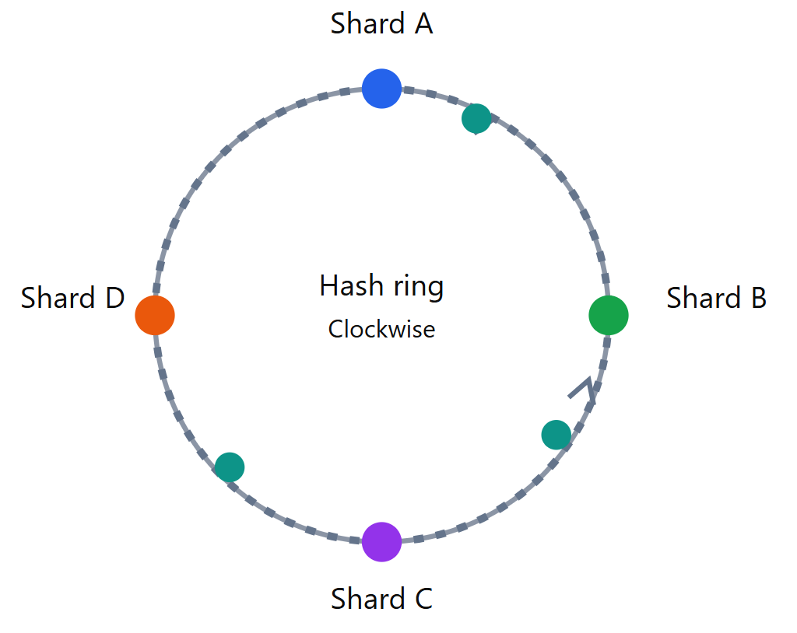
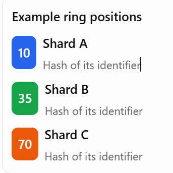
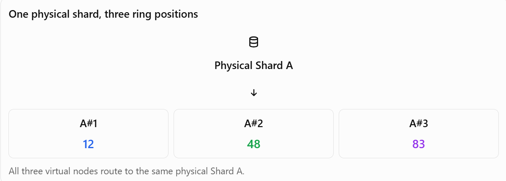

### Agenda
1. [Sharding](#sharding)
   * Definition
   * Objective
   * [Sharding Key](#sharding-key-)
2. [Types of Sharding](#types-of-sharding)
   * Range-Based Sharding
   * Hash-Based Sharding
   * Directory-Based Sharding
   * Composite Sharding
   * Geo-Based Sharding
3. [Sharding Algorithms](#sharding-algorithms-tell-in-which-shard-the-data-will-go)
    * Modulo
    * Range-Based
    * Consistent Hashing
    * Optimized Consistent Hashing
    * Dynamic Sharding Algorithms
    * Machine Learning-Based Sharding
4. [Sharding vs Replication](#sharding-vs-replication)


## Sharding
A database partitioning technique that divides a large database(unable to fit in one machine) into smaller, more manageable pieces called shards, each hosted on a separate database server to improve performance and scalability.

Sharding is simply "Horizontal Partitioning across server".

Which data in which machine is decided by developer or system designer based on the sharding key.

**Objective of sharding**:
1. Improve performance by distributing the load across multiple servers.
2. Enhance scalability by allowing the system to grow by adding more servers.
3. Increase availability by isolating failures to individual shards.
4. Reduce latency by placing shards closer to users geographically.
5. Optimize resource utilization by balancing the data and workload across servers.
6. Facilitate easier maintenance and management of large datasets.
7. Enable handling of large volumes of data that exceed the capacity of a single server.
8. Support high-throughput applications by distributing read and write operations across multiple shards.
9. Efficient Query Execution.

#### Sharding Key: 
Attribute or set of attributes used to determine how data is distributed across shards.(in which shard a particular row will go)

### Types of Sharding:
1. **Range-Based Sharding** - Data is divided based on ranges of a specific attribute (e.g., user ID ranges).

Possible Example: Users with IDs 1-1000 go to Shard 1, 1001-2000 go to Shard 2, and so on.

Pros:
* Simple to implement and understand.
* Efficient for range queries.
* Easy to scale by adding new shards for new ranges.

Cons:
* Can lead to uneven data distribution if ranges are not well-defined.
* Hotspots may occur if certain ranges receive significantly more traffic.
* Rebalancing shards can be complex if data distribution changes over time.

When to use:
* When data can be logically divided into ranges.
* When queries often target specific ranges of data.
* When there is a need for ordered data retrieval.

Real applications:
* Time-series data (e.g., logs, sensor data)
* E-commerce platforms (e.g., product IDs, order dates)
* Social media applications (e.g., user IDs, post timestamps)

2. **Hash-Based Sharding** - A hash function is applied to a specific attribute to determine the shard placement.
   
Possible Example: A hash function is applied to the user ID, and the result determines which shard the data goes to.
   
Pros:
* Provides a more uniform data distribution.
* Reduces the likelihood of hotspots.
* Easier to scale by adding new shards and rehashing data.
* Handles high write loads effectively.
* Good for workloads with random access patterns.
* Minimizes data skew.
* Facilitates load balancing across shards.
* Simplifies shard management.
* Supports high concurrency.
* Enables efficient use of storage resources.
* Improves fault tolerance by distributing data evenly.
* Enhances performance for read and write operations.

Cons:
* More complex to implement due to the need for a hash function.
* Can make range queries less efficient.
* Rehashing may be required when adding or removing shards.

When to use:
* When uniform data distribution is critical.
* When the workload involves random access patterns.
* When scalability and load balancing are priorities.

Real applications:
* Large-scale web applications (e.g., user profiles, session data)
* Content delivery networks (e.g., caching content based on URL hashes)
* Distributed databases (e.g., NoSQL databases like Cassandra, MongoDB)

3. **Directory-Based Sharding** - A lookup table is maintained to map data to specific shards.

Possible Example: A directory maps user IDs to specific shards based on predefined rules.

Pros:
* Provides flexibility in data distribution.
* Allows for complex sharding strategies.
* Easy to change shard assignments without rehashing data.
* Facilitates dynamic shard management.
* Enables fine-grained control over data placement.
* Supports heterogeneous shard configurations.
* Simplifies data migration between shards.
* Enhances data locality for specific access patterns.

Cons:
* Introduces additional overhead for maintaining the directory.
* Can become a bottleneck if the directory is not efficiently managed.
* Increases complexity in shard management.
* Requires careful design to avoid single points of failure.

When to use:
* When data distribution needs to be highly customizable.
* When shard assignments may change frequently.
* When complex access patterns require specific data placements.

Real applications:
* Multi-tenant applications (e.g., SaaS platforms with varying tenant requirements)
* Applications with dynamic data distribution needs (e.g., gaming platforms)
* Content management systems (e.g., CMS with diverse content types)
4. Composite Sharding - Combines multiple sharding strategies to optimize data distribution.

Possible Example: Using range-based sharding for user IDs and hash-based sharding for session data

Pros:
* Leverages the strengths of multiple sharding techniques.
* Provides flexibility in handling diverse data types.
* Optimizes performance for different access patterns.
* Enhances scalability by combining strategies.
* Improves fault tolerance by diversifying data distribution methods.
* Enables tailored data placement for specific workloads.
* Facilitates efficient resource utilization across shards.
* Supports complex application requirements.
* Enhances overall system performance by optimizing data access.

Cons:
* Increases complexity in implementation and management.
* Requires careful planning to avoid conflicts between sharding strategies.
* May introduce additional overhead in shard management.
* Requires sophisticated monitoring to ensure optimal performance.

When to use:
* When dealing with diverse data types and access patterns.
* When single sharding strategies do not meet performance requirements.
* When scalability and flexibility are critical.

Real applications:
* E-commerce platforms (e.g., combining product and user data sharding)
* Social media applications (e.g., combining user profiles and content data sharding)
* Educational platforms (e.g., combining student and course data sharding)

5. **Geo-Based Sharding** - Data is partitioned based on geographical location to reduce latency for users in different regions.

Possible Example: Users from North America are directed to Shard 1, while users from Europe are directed to Shard 2.

Pros:
* Reduces latency by placing data closer to users.
* Improves performance for geographically distributed user bases.
* Enhances user experience by minimizing response times.
* Facilitates compliance with data residency regulations.
* Supports localized data management.
* Enables efficient handling of region-specific workloads.
* Improves fault tolerance by isolating regional failures.

Cons:
* Can lead to uneven data distribution if user bases are not evenly spread.
* Requires careful management of data synchronization across regions.
* May introduce complexity in shard management due to geographical considerations.
* Requires robust infrastructure to support global distribution.

When to use:
* When serving a global user base with significant geographical distribution.
* When latency reduction is a priority for user experience.
* When compliance with regional data regulations is necessary.

Real applications:
* Global e-commerce platforms (e.g., Amazon, eBay)
* Social media networks (e.g., Facebook, Twitter)
* Content delivery networks (e.g., Akamai, Cloudflare)
* Online gaming platforms (e.g., Fortnite, PUBG)
* Video streaming services (e.g., Netflix, YouTube)
* Cloud service providers (e.g., AWS, Azure, Google Cloud)
* Financial services (e.g., international banking platforms)
* Travel and booking platforms (e.g., Airbnb, Booking.com)
* News and media websites (e.g., BBC, CNN)
* Educational platforms with global reach (e.g., Coursera, edX)
* Healthcare platforms serving multiple regions (e.g., telemedicine services)
* Collaboration tools (e.g., Slack, Microsoft Teams)
* Ride-sharing services (e.g., Uber, Lyft)
* Food delivery services (e.g., Uber Eats, DoorDash)
* Online marketplaces (e.g., Etsy, Alibaba)
* Real-time communication platforms (e.g., Zoom, Skype)
* Cloud-based productivity suites (e.g., Google Workspace, Microsoft 365)
* Online forums and communities (e.g., Reddit, Stack Overflow)
* E-learning platforms with international users (e.g., Duolingo, Khan Academy)
* Virtual event platforms (e.g., Hopin, Eventbrite)
* Remote work platforms (e.g., GitHub, GitLab)
* Global logistics and supply chain platforms (e.g., FedEx, DHL)

Summary/ Table having different type of Sharding and when to use and when to avoid with real applications:

| Sharding Type        | When to Use                                         | When to Avoid                                      | Real Applications                                  |
|----------------------|-----------------------------------------------------|----------------------------------------------------|---------------------------------------------------|
| Range-Based Sharding | Logical data ranges, range queries                  | Uneven data distribution, hotspots                    | Time-series data, e-commerce, social media        |
| Hash-Based Sharding | Uniform distribution, random access patterns       | Complex implementation, inefficient range queries   | Web applications, CDNs, distributed databases |
| Directory-Based Sharding | Customizable distribution, dynamic shard assignments | Directory overhead, single points of failure          | Multi-tenant apps, dynamic data distribution, CMS  |
| Composite Sharding | Diverse data types, complex access patterns         | Increased complexity, management overhead           | E-commerce, social media, educational platforms |
| Geo-Based Sharding  | Global user base, latency reduction                     | Uneven distribution, data synchronization complexity | Global e-commerce, social media, CDNs            |


#### Sharding Algorithms: Tell in which Shard the data will go

1. **Modulo**: 

shardId = shardingKey % numberOfShards

Example: Sharding key is user_id and we have 4 shard (machine)

```
getShard(user_id) =user_id % number_of_shards
```

A uniformly distributed set of key values and a uniformly distributed workload are not the same thing.

```
| Customer ID | Calculation | Shard |
|---|---|---|
| 100 | 100 % 4 = 0 | Shard 0 |
| 101 | 101 % 4 = 1 | Shard 1 |
| 102 | 102 % 4 = 2 | Shard 2 |
| 103 | 103 % 4 = 3 | Shard 3 |
| 104 | 104 % 4 = 0 | Shard 0 |
| 105 | 105 % 4 = 1 | Shard 1 |
| 106 | 106 % 4 = 2 | Shard 2 |
| 107 | 107 % 4 = 3 | Shard 3 |
```

Consider these two cases:
```
Case A: Balanced

Keys: 100, 101, 102, 103, 104, 105, 106, 107

With % 4, each shard receives two keys.

Result: balanced record count.
```
```
Case B: Skewed

Keys: 100, 104, 108, 112, 116, 120, 124, 128

Every key is divisible by 4, so every record goes to Shard 0.

Result: severe imbalance, despite the keys being distinct and increasing.
```
Pros: 

Simple

Uniform Distribution if sharding key is uniformly distributed

Cons: 

Scalability issue - when we add or remove the shard we need to do a lot of data transfer between Shards. 

with modulo sharding, changing the shard count from 4 to 5 can remap most records, because the divisor changes. This can make scaling operationally expensive.]\]\


**Design A: Direct modulo sharding**
In direct modulo sharding, a fixed number of shards are used, 
and the sharding key is directly used to determine the shard. 
This approach is simple but can lead to uneven data distribution 
if the sharding key is not uniformly distributed.
```
Suppose your routing logic is:

shardId = hash(orderid)%4

Every order is assigned directly to a physical shard.

When you add a fifth shard, you might change the formula to:

shardId = hash(orderid)%5

That changes the destination for many existing orders.
```

**Design B: Stable buckets + a mapping table**
Instead, calculate a logical bucket independently of the number of physical servers:

bucketId=hash(orderId)% 16

Then use a separate mapping to find the physical shard.

### Initial Mapping: 4 Physical Shards

| Logical Buckets | Physical Shard |
|---|---|
| 0, 1, 2, 3 | Shard 0 |
| 4, 5, 6, 7 | Shard 1 |
| 8, 9, 10, 11 | Shard 2 |
| 12, 13, 14, 15 | Shard 3 |

Now suppose you add Shard . You can move selected buckets to it:

**After: 5 physical shards**

| Physical Shard | Logical Buckets |
|---|---|
| Shard 0 | 1, 2, 3 |
| Shard 1 | 4, 5, 6 |
| Shard 2 | 8, 9, 10 |
| Shard 3 | 12–15 |
| Shard 4 | 0, 7, 11 |


 What Stays Unchanged?

- An order's `bucketId` remains the same.
- The application still calculates the bucket using `% 16`.
- Only the mapping from bucket to physical shard changes for selected buckets.

> If buckets 0, 7, and 11 move, the application updates their mapping and migrates their data. It does not need to recalculate the logical bucket IDs for all orders.

Stable buckets + a mapping table is helpful if we have more logical buckets than physical shards .


2. **Range-Based**: Define ranges for each shard like 0-250 to Shard 1, 251-500 to Shard 2 so on....

Pros: Simple to implement and understand.

Efficient for range queries.

Easy to scale by adding new shards for new ranges.

Cons: Can lead to uneven data distribution if ranges are not well-defined.

Hotspots may occur if certain ranges receive significantly more traffic.

Rebalancing shards can be complex if data distribution changes over time.

3. **Consistent Hashing**: 

Consistent hashing is a technique used in distributed systems to distribute data across servers 
while minimizing how much data needs to move when servers are added or removed.

Problem : When a server is added or removed, a large amount of data needs to be redistributed across the remaining servers.

Aim: Consistent hashing is designed to reduce this reshuffling.

Use a hash function to map both data and shards to a circular space. 

Data is assigned to the nearest shard in the clockwise direction.



Step-by-step example
1. Give each shard (Physical database) a unique identifier, such as Shard-A, Shard-B, and Shard-C
```   
   Shard A → "server-A"
   Shard B → "server-B"
   Shard C → "server-C"
```
2. Apply a hash function, to determine its position on the ring.
```
hash("server-A") → 10    // illustrative result
hash("server-B") → 35    // illustrative result
hash("server-C") → 70    // illustrative result
```
Java code
```
int position = "server-A".hashCode();
System.out.println(position);
```
3. Place the position on the ring - The hash positions determine where the shards sit on the ring. We then sort those positions to determine the clockwise order.

4. Hash each key, such as order-101, to find its position.
3. Move clockwise from the key's position until you reach the first server.
4. Store or retrieve the key on that server.

For example, if order-101 hashes between Shard A and Shard B, it belongs to Shard B.

Suppose Shard E is added between Shard A and Shard B.

Before adding Shard E - Keys in the relevant ring interval belong to Shard B.

After adding Shard E - Only keys in the interval now claimed by Shard E need to move from Shard B to Shard E.

Pros: 

Scalability - Adding or removing a shard only affects a small portion of the data.

Reduces data movement during scaling operations.

Provides a more uniform data distribution.

Cons: 

Reduce load of only one Shard.

More complex to implement.

May require virtual nodes to improve distribution.

Can make range queries less efficient.

When to use: 

When scalability is a priority.

When dealing with dynamic shard membership.

When uniform data distribution is critical.

4. **Optimized Consistent Hashing**: An enhanced version of consistent hashing that incorporates virtual nodes and load balancing techniques to further optimize data distribution and minimize hotspots.
* This is used by MangoDB internally
* Use Multiple hash function to find number of shard for a particular key. and load the data on all those Shards.


Problem with previous approach:

The problem is that each shard may own a very different-sized section of the ring. Shard A might receive many more keys than Shard B.

One position per physical server can lead to uneven data distribution.

The solution: virtual nodes

Instead of giving each physical shard one position, we give it multiple positions on the ring.

For example:

| Physical shard | Virtual node positions |
|---|---|
|Shard A   |A1 = 10, A2 = 45, A3 = 85   |
|Shard B   |B1 = 25, B2 = 60, B3 = 95   |
|Shard C   |C1 = 15, C2 = 50, C3 = 75   |

Each virtual node is a logical position on the ring, but it points back to the same physical database.

Position calculation:

1. Suppose we have one physical database shard, Shard-A, and we want it to have 3 virtual nodes.
2. Give three unique identifier to all virtual nodes, such as A1, A2, and A3.
3. Apply a hash function to each virtual node identifier to determine its position on the ring.



The main optimizations are:
1. Use a sorted ring with efficient lookups. Instead of linear search use binary search
2. Use virtual nodes to improve distribution.
3. Use a good hash function to minimize collisions and clustering.
4. Rebalance only affected key ranges when nodes change.
5. Coordinate ring updates and data migration safely.

Its main advantage is to improve distribution:

Consider an order whose hash position is 40.
- The next virtual node clockwise is A2 at 45.
- A2 belongs to physical Shard A.
- Therefore, the order is stored on Shard A.

Another order might map to B1, C2, or another virtual node. Each physical shard owns several separate intervals around the ring instead of just one interval.

This usually improves balance because each shard gets many opportunities to own portions of the ring.

Adding new Shard: 

Suppose we add Shard D with its own virtual nodes.

The new virtual-node positions claim portions of the ring previously owned by existing nodes. Only keys in those affected intervals normally need to move to Shard D, rather than redistributing all keys.

The exact amount of movement depends on the node placement and distribution.

```
int virtualNodeCount = 100;

for (int i = 0; i < virtualNodeCount; i++) {
    String nodeId = "Shard-A#" + i;

    long position = hash(nodeId);

    ring.put(position, "Shard-A");
}
```

The ordered map stores the virtual-node position as the key and its owning physical shard as the value.
```
Hash position	Virtual node	Physical shard
12	            A#0	            Shard A
25	            B#0	            Shard B
48	            A#1	            Shard A
60	            C#0	            Shard C
73	            B#1	            Shard B
83	            A#2	            Shard A
91	            C#1	            Shard C
95	            B#2	            Shard B
98	            C#2	            Shard C
```

5. **Dynamic Sharding Algorithms**: Algorithms that adapt to changing data patterns and workloads in real-time, optimizing shard assignments based on current system conditions.
6. **Machine Learning-Based Sharding**: Utilizing machine learning techniques to predict data access patterns and optimize

#### Summary of Sharding Algorithms:

| Sharding Algorithm | Speed    | Uniform Distribution | Scalability         | Complexity |
|--------------------|----------|----------------------|---------------------|------------|
| Modulo             | Fast     | Uniform Distribution | NA                  | Simple     |
| Range Based        | Fast     | NA                   | Add and remove easy | Simple     |
| Consistent Hashing | Moderate | Good                 | High                | Moderate   |

### Which Algorithm should you choose

| Situation | Suitable approach |
|---|---|
| Distribute keys while minimizing reshuffling | Consistent hashing |
| Move selected groups of data under explicit control | Logical buckets + placement map |
| Split a range-based shard | Range splitting |
| Scale automatically based on workload | Dynamic rebalancing controller plus a migration protocol |

